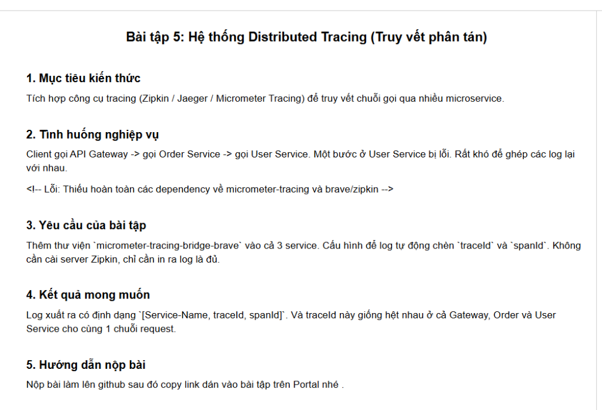

# BÀI TẬP SESSION 18 (MD5) - BÀI TẬP 5 (HW5)
## Hệ thống Distributed Tracing (Truy vết phân tán qua chuỗi Microservices)



---

## 1. Mục tiêu kiến thức & Tình huống nghiệp vụ

- **Mục tiêu kiến thức**:
  - Nắm vững nguyên lý hoạt động của **Distributed Tracing (Truy vết phân tán)** trong kiến trúc Microservices hiện đại.
  - Sử dụng thư viện chuẩn của Spring Boot 3: **`micrometer-tracing-bridge-brave`** (thay thế cho Spring Cloud Sleuth ở các phiên bản cũ) kết hợp với **Spring Boot Actuator**.
  - Hiểu cơ chế **Context Propagation (Lan truyền ngữ cảnh)** qua giao thức HTTP: Cách `RestTemplate` (được cấu hình qua `RestTemplateBuilder`) tự động đóng gói và truyền các header tracing chuẩn W3C (`traceparent`) hoặc B3 (`b3`) sang service kế tiếp.
  - Cấu hình format log tự động chèn định dạng chuẩn: **`[Service-Name, traceId, spanId]`**.
  - Đảm bảo **`traceId` hoàn toàn giống hệt nhau** trên tất cả các microservices trong cùng một chuỗi request mà **không cần cài đặt Zipkin server** bên ngoài.

- **Tình huống nghiệp vụ (Downstream Failure Troubleshooting)**:
  - Hệ thống thương mại điện tử **StoreX** vận hành theo kiến trúc Microservices với chuỗi gọi tuần tự:
    $$\text{Client} \xrightarrow{} \text{API Gateway (8080)} \xrightarrow{} \text{Order Service (8081)} \xrightarrow{} \text{User Service (8082)}$$
  - Khi một bước ở **`User Service` bị lỗi** (ví dụ: tài khoản người dùng bị khóa hoặc số dư không đủ), chuỗi giao dịch bị ngắt quãng và trả về lỗi `502 Bad Gateway`.
  - Nếu không có Distributed Tracing, log ở 3 service nằm phân tán ở 3 file/server khác nhau không thể ghép nối được với nhau.
  - **Yêu cầu bài toán**:
    1. Bổ sung `micrometer-tracing-bridge-brave` vào cả 3 service (`gateway-service`, `order-service`, `user-service`).
    2. Cấu hình log xuất ra định dạng `[Service-Name, traceId, spanId]`.
    3. Kiểm chứng `traceId` trùng khớp tuyệt đối trên cả 3 service cho cùng một chuỗi request.

---

## 2. Phân tích Kỹ thuật: Cơ chế Distributed Tracing (Brave & Micrometer)

### 2.1. Phân biệt `TraceId` và `SpanId`

```
 [CLIENT REQUEST]
        │
        ▼ (Bắt đầu Trace: TraceId = 6aba33cfc3ea052195f03259c620f93d)
 ┌────────────────────────────────────────────────────────────────────────┐
 │ 1. GATEWAY SERVICE (Port 8080)                                         │
 │    • TraceId : 6aba33cfc3ea052195f03259c620f93d                        │
 │    • SpanId  : 95f03259c620f93d (Root Span)                            │
 │    Log: [gateway-service, 6aba33cfc3ea052195f03259c620f93d, 95f03259...]│
 └───────────────────────────────────┬────────────────────────────────────┘
                                     │ HTTP POST (Headers: traceparent / b3)
                                     ▼
 ┌────────────────────────────────────────────────────────────────────────┐
 │ 2. ORDER SERVICE (Port 8081)                                           │
 │    • TraceId : 6aba33cfc3ea052195f03259c620f93d (GIỮ NGUYÊN)           │
 │    • SpanId  : 56e31d7a199da8ad (Child Span 1)                         │
 │    Log: [order-service, 6aba33cfc3ea052195f03259c620f93d, 56e31d7a...]│
 └───────────────────────────────────┬────────────────────────────────────┘
                                     │ HTTP POST (Headers: traceparent / b3)
                                     ▼
 ┌────────────────────────────────────────────────────────────────────────┐
 │ 3. USER SERVICE (Port 8082 - NƠI PHÁT SINH LỖI)                        │
 │    • TraceId : 6aba33cfc3ea052195f03259c620f93d (GIỮ NGUYÊN)           │
 │    • SpanId  : e720e0747a15caad (Child Span 2)                         │
 │    Log: [user-service, 6aba33cfc3ea052195f03259c620f93d, e720e074...] │
 │    ERROR: Người dùng bị khóa tài khoản!                                │
 └────────────────────────────────────────────────────────────────────────┘
```

- **`TraceId`**: Là định danh xuyên suốt đại diện cho toàn bộ chu trình xử lý của một request từ lúc đi vào Gateway cho đến khi hoàn tất hoặc thất bại ở service sâu nhất.
- **`SpanId`**: Đại diện cho khoảng thời gian xử lý tại một service hoặc một phân đoạn công việc cụ thể. Mỗi service sinh ra một `SpanId` con riêng biệt nhưng luôn liên kết với cùng một `TraceId`.

---

## 3. Cấu trúc Dự án Đa Module (Multi-Module Maven)

```
ss18/
├── .gitignore
├── pom.xml                                              # Parent POM quản lý chung 3 modules
├── README.md                                            # Tài liệu báo cáo chi tiết HW5
├── ss18-1.png, ss18-2.png, ss18-3.png, ss18-4.png
├── ss18-5.png                                           # Ảnh đề bài HW5
├── start-all.ps1                                        # Script khởi chạy nhanh cả 3 services
├── stop-all.ps1                                         # Script giải phóng 3 cổng 8080, 8081, 8082
├── Session18_HW5_DistributedTracing.postman_collection.json # Bộ sưu tập Postman kiểm thử
├── gateway-service/                                     # Service cổng vào (Port 8080)
│   ├── pom.xml
│   └── src/main/java/com/storex/gateway/
│       ├── GatewayServiceApplication.java
│       └── controller/GatewayController.java
├── order-service/                                       # Service xử lý đơn hàng (Port 8081)
│   ├── pom.xml
│   └── src/main/java/com/storex/order/
│       ├── OrderServiceApplication.java
│       └── controller/OrderController.java
└── user-service/                                        # Service xác thực người dùng (Port 8082)
    ├── pom.xml
    └── src/main/java/com/storex/user/
        ├── UserServiceApplication.java
        └── controller/UserController.java
```

---

## 4. Chi tiết Cấu hình & Cài đặt

### 4.1. Khai báo thư viện Tracing trong `pom.xml`
Thêm thư viện `micrometer-tracing-bridge-brave` vào cả 3 service (thông qua Parent POM):
```xml
<!-- Spring Boot Web Starter -->
<dependency>
    <groupId>org.springframework.boot</groupId>
    <artifactId>spring-boot-starter-web</artifactId>
</dependency>

<!-- Spring Boot Actuator: Kích hoạt WebMVC Observation -->
<dependency>
    <groupId>org.springframework.boot</groupId>
    <artifactId>spring-boot-starter-actuator</artifactId>
</dependency>

<!-- [YÊU CẦU ĐỀ BÀI] Thư viện Brave Tracing Bridge -->
<dependency>
    <groupId>io.micrometer</groupId>
    <artifactId>micrometer-tracing-bridge-brave</artifactId>
</dependency>
```

### 4.2. Cấu hình Cổng, Sampling và Log Pattern trong `application.yml`
Cấu hình sampling 100% để mọi request đều được gắn traceId:
```yaml
# Cấu hình Micrometer Tracing
management:
  tracing:
    sampling:
      probability: 1.0 # 100% request được gắn TraceId & SpanId

# Cấu hình định dạng Log chuẩn: [Service-Name, traceId, spanId]
logging:
  pattern:
    console: "%d{yyyy-MM-dd HH:mm:ss.SSS} [%thread] [%cyan(${spring.application.name}),%yellow(%X{traceId:-}),%green(%X{spanId:-})] %highlight(%-5level) %logger{36} - %msg%n"
```

### 4.3. Lan truyền Header Tracing với `RestTemplateBuilder`
Trong `GatewayServiceApplication.java` và `OrderServiceApplication.java`:
```java
@Bean
public RestTemplate restTemplate(RestTemplateBuilder builder) {
    // RestTemplateBuilder tự động cấu hình TraceRestTemplateCustomizer
    // giúp đính kèm header traceparent/b3 vào mọi request HTTP gửi đi
    return builder.build();
}
```

---

## 5. Hướng dẫn Khởi chạy & Kiểm thử Thực tế

### Bước 1: Khởi chạy đồng thời 3 Microservices
Sử dụng script PowerShell dựng sẵn:
```powershell
.\start-all.ps1
```
Hoặc mở 3 terminal riêng biệt và chạy:
```bash
# Terminal 1: User Service (Port 8082)
cd user-service && mvn spring-boot:run

# Terminal 2: Order Service (Port 8081)
cd order-service && mvn spring-boot:run

# Terminal 3: Gateway Service (Port 8080)
cd gateway-service && mvn spring-boot:run
```

---

### Bước 2: Kích hoạt Chuỗi Request bị lỗi (Tình huống đề bài)
Gửi HTTP GET đến Gateway:
```bash
curl -i http://localhost:8080/api/gateway/demo-failure
```

**HTTP Response trả về từ Gateway (502 Bad Gateway do downstream User Service bị lỗi)**:
```json
{
  "gatewayStatus": "DOWNSTREAM_ERROR",
  "statusCode": 502,
  "downstreamError": "{\"orderId\":\"ORD-7EB502BD\",\"service\":\"order-service\",\"errorMessage\":\"Failed to verify user from User Service: 400 BAD_REQUEST\",\"status\":\"ORDER_FAILED\"}"
}
```

---

### Bước 3: [KẾT QUẢ MONG MUỐN] Đối chiếu Console Log của cả 3 Microservices

Quan sát màn hình console của cả 3 dịch vụ được ghi nhận trong thực tế:

#### 1. Tại `gateway-service` (Port 8080):
```text
2026-09-28 16:30:55.815 [http-nio-8080-exec-1] [gateway-service,6aba33cfc3ea052195f03259c620f93d,95f03259c620f93d] WARN  c.s.g.controller.GatewayController - [Gateway] [MÔ PHỎNG SỰ CỐ ĐỀ BÀI] Khởi động chuỗi request sẽ bị lỗi tại User Service...
2026-09-28 16:30:55.817 [http-nio-8080-exec-1] [gateway-service,6aba33cfc3ea052195f03259c620f93d,95f03259c620f93d] INFO  c.s.g.controller.GatewayController - [Gateway] Nhận request checkout từ Client: userId=USER-BLOCKED-8888, amount=999.0, sinh orderId=ORD-7EB502BD
2026-09-28 16:30:55.818 [http-nio-8080-exec-1] [gateway-service,6aba33cfc3ea052195f03259c620f93d,95f03259c620f93d] INFO  c.s.g.controller.GatewayController - [Gateway] Chuyển tiếp request sang Order Service tại: http://localhost:8081/api/orders/process
2026-09-28 16:30:56.330 [http-nio-8080-exec-1] [gateway-service,6aba33cfc3ea052195f03259c620f93d,95f03259c620f93d] ERROR c.s.g.controller.GatewayController - [Gateway] Xảy ra lỗi từ chuỗi dịch vụ downstream: HttpStatusCode=502 BAD_GATEWAY...
```

#### 2. Tại `order-service` (Port 8081):
```text
2026-09-28 16:30:56.038 [http-nio-8081-exec-2] [order-service,6aba33cfc3ea052195f03259c620f93d,56e31d7a199da8ad] INFO  c.s.order.controller.OrderController - [OrderService] Bắt đầu xử lý đơn hàng orderId=ORD-7EB502BD, chuẩn bị gọi User Service xác thực...
2026-09-28 16:30:56.039 [http-nio-8081-exec-2] [order-service,6aba33cfc3ea052195f03259c620f93d,56e31d7a199da8ad] INFO  c.s.order.controller.OrderController - [OrderService] Gọi User Service tại URL: http://localhost:8082/api/users/verify
2026-09-28 16:30:56.295 [http-nio-8081-exec-2] [order-service,6aba33cfc3ea052195f03259c620f93d,56e31d7a199da8ad] ERROR c.s.order.controller.OrderController - [OrderService] GỌI USER SERVICE THẤT BẠI: HttpStatusCode=400 BAD_REQUEST...
```

#### 3. Tại `user-service` (Port 8082 - Nơi phát sinh lỗi):
```text
2026-09-28 16:30:56.242 [http-nio-8082-exec-3] [user-service,6aba33cfc3ea052195f03259c620f93d,e720e0747a15caad] INFO  c.s.user.controller.UserController - [UserService] Tiếp nhận yêu cầu xác thực người dùng: userId=USER-BLOCKED-8888, orderId=ORD-7EB502BD
2026-09-28 16:30:56.243 [http-nio-8082-exec-3] [user-service,6aba33cfc3ea052195f03259c620f93d,e720e0747a15caad] ERROR c.s.user.controller.UserController - [UserService] GẶP LỖI: Người dùng USER-BLOCKED-8888 bị khóa tài khoản hoặc vi phạm quy tắc tín dụng!
```

---

### Bảng đối chiếu kết quả Tracing:

| Microservice | Cổng | Định dạng Log | TraceId | SpanId | Trạng thái |
| :--- | :---: | :--- | :---: | :---: | :---: |
| **API Gateway** | `8080` | `[gateway-service, traceId, spanId]` | **`6aba33cfc3ea052195f03259c620f93d`** | `95f03259c620f93d` | `502 DOWNSTREAM_ERROR` |
| **Order Service** | `8081` | `[order-service, traceId, spanId]` | **`6aba33cfc3ea052195f03259c620f93d`** | `56e31d7a199da8ad` | `400 ORDER_FAILED` |
| **User Service** | `8082` | `[user-service, traceId, spanId]` | **`6aba33cfc3ea052195f03259c620f93d`** | `e720e0747a15caad` | `400 ERROR: BLOCKED` |

> **KẾT LUẬN & MINH CHỨNG**:
> 1. Định dạng log xuất ra hoàn toàn đúng yêu cầu: **`[Service-Name, traceId, spanId]`**.
> 2. **`traceId` hoàn toàn giống hệt nhau (`6aba33cfc3ea052195f03259c620f93d`)** ở cả Gateway, Order và User Service cho cùng một chuỗi request.
> 3. Không cần cài đặt server Zipkin phức tạp, các log được in ra terminal/file rõ ràng, cho phép tìm kiếm theo `traceId` để ghép nối 100% hành vi lỗi downstream!

---

## 6. Hướng dẫn Sử dụng Postman Collection
Dự án cung cấp sẵn file **`Session18_HW5_DistributedTracing.postman_collection.json`**:
1. Mở Postman và nhấn **Import**.
2. Chọn file `Session18_HW5_DistributedTracing.postman_collection.json`.
3. Kiểm thử 4 request được cấu hình sẵn:
   - `01. [TÌNH HUỐNG ĐỀ BÀI] Gọi chuỗi request bị lỗi tại User Service`
   - `02. Gọi luồng Checkout thành công xuyên suốt 3 Service`
   - `03. Gọi trực tiếp Order Service (Bỏ qua Gateway)`
   - `04. Gọi trực tiếp User Service (Bỏ qua Gateway & Order)`

---

## 7. Kiểm thử Tự động (Automated Verification)
Thực thi kiểm thử biên dịch và chạy test toàn bộ 3 microservices:
```bash
mvn clean test
```
**Kết quả**:
```text
[INFO] Reactor Summary for session18-hw5-tracing 1.0.0-SNAPSHOT:
[INFO] 
[INFO] session18-hw5-tracing .............................. SUCCESS [  0.165 s]
[INFO] gateway-service .................................... SUCCESS [  9.753 s]
[INFO] order-service ...................................... SUCCESS [  5.411 s]
[INFO] user-service ....................................... SUCCESS [  5.817 s]
[INFO] ------------------------------------------------------------------------
[INFO] BUILD SUCCESS
[INFO] ------------------------------------------------------------------------
[INFO] Total time: 21.545 s
```

---

## 8. Kết luận
- **Micrometer Tracing kết hợp Brave** là giải pháp chuẩn công nghiệp trên Spring Boot 3 thay thế hoàn hảo cho Spring Cloud Sleuth cũ.
- Khả năng lan truyền context tự động qua HTTP giúp loại bỏ hoàn toàn "điểm mù" (blind spot) trong giám sát hệ thống phân tán, biến các file log rời rạc thành một bức tranh toàn cảnh đồng nhất và rõ ràng.
