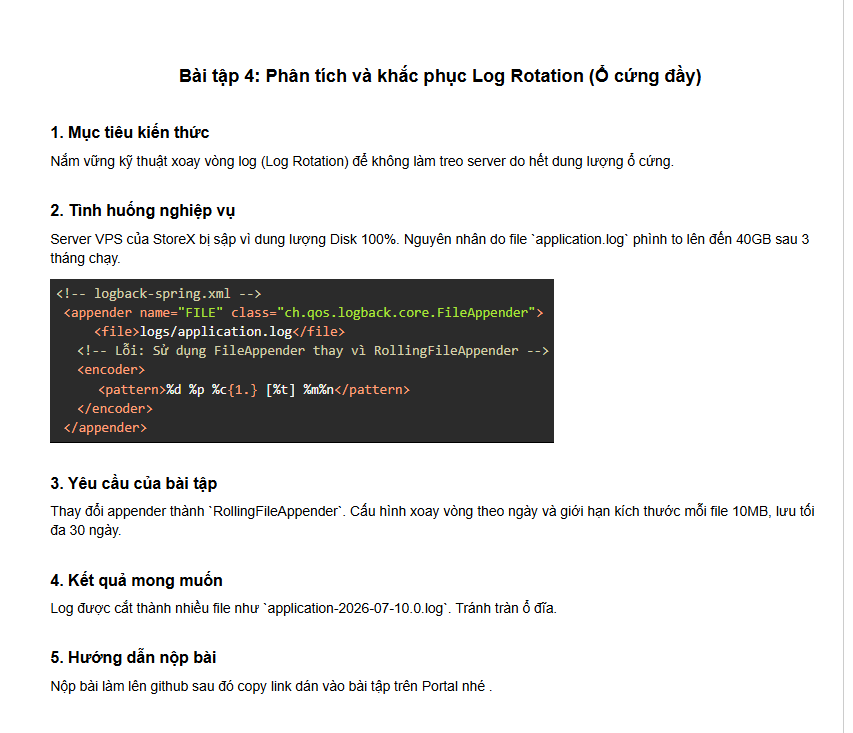

# BÀI TẬP SESSION 18 (MD5) - BÀI TẬP 4 (HW4)
## Phân tích và khắc phục Log Rotation (Sự cố sập server do ổ cứng đầy)



---

## 1. Mục tiêu kiến thức & Tình huống nghiệp vụ

- **Mục tiêu kiến thức**:
  - Nắm vững nguyên lý và kỹ thuật **xoay vòng log (Log Rotation)** trong Logback framework kết hợp với Spring Boot.
  - Phân biệt rõ rệt giữa **`FileAppender`** (ghi dồn một file duy nhất) và **`RollingFileAppender`** (tự động phân đoạn và dọn dẹp log theo chính sách).
  - Làm chủ cấu hình **`SizeAndTimeBasedRollingPolicy`**: Xoay vòng file log kết hợp cả 2 điều kiện: **theo ngày (`%d{yyyy-MM-dd}`)** và **theo kích thước dung lượng (`maxFileSize = 10MB`)**.
  - Hiểu cách thiết lập giới hạn lưu trữ tối đa (**`maxHistory = 30 ngày`**) và trần dung lượng an toàn (**`totalSizeCap = 3GB`**) để bảo vệ máy chủ khỏi nguy cơ cạn kiệt dung lượng đĩa (**Disk Full / 100% Usage**).

- **Tình huống nghiệp vụ (Production Outage - Disk Full 100%)**:
  - Máy chủ VPS của hệ thống thương mại điện tử **StoreX** bất ngờ bị treo cứng và sập toàn bộ dịch vụ (Downtime nghiêm trọng).
  - Đội ngũ hạ tầng (SRE/DevOps) kiểm tra và phát hiện dung lượng phân vùng ổ cứng đĩa chứa hệ điều hành đã đạt ngưỡng **100% (No space left on device)**.
  - **Nguyên nhân gốc rễ**: File `logs/application.log` sau 3 tháng vận hành đã phình to vượt mức **40GB** mà không hề được cắt file hay xóa bớt.
  - **Phân tích cấu hình cũ**:
    ```xml
    <!-- LỖI NGHIÊM TRỌNG TRONG LOGBACK: Dùng FileAppender -->
    <appender name="FILE" class="ch.qos.logback.core.FileAppender">
        <file>logs/application.log</file>
        <encoder>
            <pattern>%d %p %c{1.} [%t] %m%n</pattern>
        </encoder>
    </appender>
    ```
    `FileAppender` là appender ghi nối tiếp (append) vĩnh viễn vào một file duy nhất. Ứng dụng chạy càng lâu thì file càng lớn đến khi bóp nghẹt toàn bộ ổ cứng server!
  - **Giải pháp**: Thay thế bằng `RollingFileAppender` với cấu hình xoay vòng theo ngày, kích thước mỗi file 10MB, lưu tối đa 30 ngày.

---

## 2. Phân tích Kỹ thuật: FileAppender vs. RollingFileAppender

### 2.1. Bảng so sánh kỹ thuật

| Tiêu chí | FileAppender (Cấu hình lỗi cũ) | RollingFileAppender (Giải pháp chuẩn) |
| :--- | :--- | :--- |
| **Cơ chế ghi** | Ghi dồn liên tục vào 1 file duy nhất | Ghi vào file hiện hành, tự động cắt khi đạt ngưỡng |
| **Hành vi theo thời gian** | File phình to vô hạn (10GB, 40GB, 100GB...) | Mỗi file cố định tối đa 10MB, phân tách theo ngày |
| **Khả năng dọn dẹp** | **Không có**: Cần can thiệp xóa bằng tay hoặc cron script bên ngoài | **Tự động**: Xóa các file cũ hơn 30 ngày (`maxHistory`) |
| **Khả năng đọc/tra cứu** | Cực kỳ khó mở; mở file 40GB bằng vi/nano/notepad sẽ làm crash RAM máy chủ | Dễ dàng mở, phân tích và chia nhỏ cho shipper đẩy lên ELK |
| **Nguy cơ hệ thống** | **Rất cao**: Gây sập toàn bộ VPS khi Disk đạt 100% | **Tuyệt đối an toàn**: Giới hạn trần dung lượng đĩa |

---

### 2.2. Sơ đồ cơ chế xoay vòng `SizeAndTimeBasedRollingPolicy`

```
                            [ CƠ CHẾ LOG ROTATION THEO THỜI GIAN & KÍCH THƯỚC ]

             Luồng log từ ứng dụng Spring Boot
                           │
                           ▼
                 ┌───────────────────┐
                 │  application.log  │  <── File log hiện hành đang nhận dữ liệu
                 └─────────┬─────────┘
                           │
            Kiểm tra 2 điều kiện xoay vòng:
            ├── 1. Sang ngày mới? (Midnight Rollover)
            └── 2. Dung lượng vượt quá 10MB? (Size Rollover)
                           │
                           ▼
          ┌────────────────────────────────────────────────────────┐
          │     Các file lưu trữ quá khứ (Archived Log Files)      │
          ├────────────────────────────────────────────────────────┤
          │  logs/application-2026-09-27.0.log (10 MB)            │
          │  logs/application-2026-09-28.0.log (10 MB)            │
          │  logs/application-2026-09-28.1.log (10 MB)            │
          │  logs/application-2026-09-28.2.log (10 MB)            │
          │  ...                                                   │
          │  logs/application-2026-09-28.n.log                    │
          └────────────────────────┬───────────────────────────────┘
                                   │
                      Tự động xóa sau 30 ngày (maxHistory = 30)
                      Tổng dung lượng kiểm soát <= 3GB (totalSizeCap)
                                   ▼
                            [ Ổ CỨNG AN TOÀN ]
```

---

## 3. Cấu hình Chuẩn hóa trong `logback-spring.xml`

Cấu hình khắc phục triệt để sự cố theo đúng yêu cầu đề bài:

```xml
<?xml version="1.0" encoding="UTF-8"?>
<configuration scan="true" scanPeriod="30 seconds">

    <property name="CONSOLE_LOG_PATTERN"
              value="%d{yyyy-MM-dd HH:mm:ss.SSS} [%thread] %magenta([%X{requestId:-SYSTEM}]) %highlight(%-5level) %cyan(%logger{36}) - %msg%n"/>

    <property name="FILE_LOG_PATTERN"
              value="%d{yyyy-MM-dd HH:mm:ss.SSS} [%thread] [%X{requestId:-SYSTEM}] %-5level %logger{36} - %msg%n"/>

    <!-- 1. Console Appender -->
    <appender name="CONSOLE" class="ch.qos.logback.core.ConsoleAppender">
        <encoder class="ch.qos.logback.classic.encoder.PatternLayoutEncoder">
            <pattern>${CONSOLE_LOG_PATTERN}</pattern>
            <charset>UTF-8</charset>
        </encoder>
    </appender>

    <!-- 2. [HW4] RollingFileAppender: Khắc phục triệt để sự cố 40GB Disk Full -->
    <appender name="FILE" class="ch.qos.logback.core.rolling.RollingFileAppender">
        <!-- File log hiện hành đang được ứng dụng ghi trực tiếp -->
        <file>logs/application.log</file>

        <!-- Chính sách xoay vòng kết hợp Ngày và Kích thước (Logback 1.4+ / Spring Boot 3) -->
        <rollingPolicy class="ch.qos.logback.core.rolling.SizeAndTimeBasedRollingPolicy">
            <!-- 1. Cấu hình xoay vòng theo ngày (%d{yyyy-MM-dd}) và chỉ số index (%i) -->
            <!-- Kết quả: application-2026-09-28.0.log, application-2026-09-28.1.log -->
            <fileNamePattern>logs/application-%d{yyyy-MM-dd}.%i.log</fileNamePattern>

            <!-- 2. Giới hạn kích thước mỗi file tối đa 10MB theo yêu cầu đề bài -->
            <maxFileSize>10MB</maxFileSize>

            <!-- 3. Lưu trữ tối đa 30 ngày theo yêu cầu đề bài (log cũ hơn tự động bị xóa) -->
            <maxHistory>30</maxHistory>

            <!-- 4. Trần tổng dung lượng tối đa toàn bộ log lưu trữ (3GB) để bảo vệ đĩa cứng VPS -->
            <totalSizeCap>3GB</totalSizeCap>
        </rollingPolicy>

        <encoder class="ch.qos.logback.classic.encoder.PatternLayoutEncoder">
            <pattern>${FILE_LOG_PATTERN}</pattern>
            <charset>UTF-8</charset>
        </encoder>
    </appender>

    <!-- Root Logger -->
    <root level="INFO">
        <appender-ref ref="CONSOLE"/>
        <appender-ref ref="FILE"/>
    </root>

</configuration>
```

### Ý nghĩa của các chỉ số trong `fileNamePattern`:
1. **`%d{yyyy-MM-dd}`**: Bộ chuyển đổi thời gian. Khi đồng hồ hệ thống chuyển sang ngày mới (00:00:00), Logback lập tức đóng file ngày cũ và kích hoạt phiên ghi mới.
2. **`%i`**: Chỉ số thứ tự phân đoạn (bắt đầu từ `0`, `1`, `2`...). Khi file log trong cùng một ngày vượt quá ngưỡng `10MB`, Logback sẽ tăng chỉ số `%i` để sinh ra file mới dạng `application-2026-09-28.0.log`, `application-2026-09-28.1.log`...
3. **`maxHistory = 30`**: Sau 30 ngày kể từ ngày tạo, các file lưu trữ sẽ tự động được thu dọn và xóa vĩnh viễn khỏi ổ cứng mà không cần người quản trị can thiệp thủ công.

---

## 4. Hướng dẫn Kiểm thử Thực tế & Minh chứng Hoạt động

### Bước 1: Khởi động Ứng dụng
```bash
mvn spring-boot:run
```

---

### Bước 2: Kiểm tra Trạng thái Thư mục Log ban đầu
Gửi HTTP GET đến endpoint quản lý log:
```bash
curl -i http://localhost:8080/api/logs/status
```

**Kết quả trả về**:
```json
{
  "exists": true,
  "totalFiles": 1,
  "totalSizeBytes": 236481,
  "totalSizeFormatted": "230.94 KB",
  "files": [
    {
      "fileName": "application.log",
      "sizeBytes": 236481,
      "sizeFormatted": "230.94 KB",
      "isRotatedArchive": false
    }
  ]
}
```
> File `application.log` đang hoạt động bình thường và dung lượng được theo dõi chặt chẽ.

---

### Bước 3: Sinh tải Log hàng loạt mô phỏng lưu lượng cao
Gửi HTTP POST để sinh 500 dòng log có cấu trúc:
```bash
curl -X POST "http://localhost:8080/api/logs/generate-bulk?count=500&prefix=ProductionBatch"
```

**Kết quả phản hồi**:
```json
{
  "status": "SUCCESS",
  "generatedLines": 500,
  "timeTakenMs": 61,
  "logDirectoryStatus": {
    "exists": true,
    "totalFiles": 1,
    "totalSizeBytes": 236481,
    "totalSizeFormatted": "230.94 KB",
    "files": [
      {
        "fileName": "application.log",
        "sizeBytes": 236481,
        "sizeFormatted": "230.94 KB",
        "isRotatedArchive": false
      }
    ]
  }
}
```

---

### Bước 4: Kiểm tra Nội dung File `logs/application.log`
Mở file `logs/application.log`, dữ liệu log được định dạng đầy đủ bao gồm thời gian, Thread, RequestId (MDC) và nội dung nghiệp vụ:
```text
2026-09-28 16:08:17.385 [main] [5a6f4c69-19eb-488a-acab-77134ec62bd9] INFO  c.s.p.service.LogRotationService - [BULK_LOG #43] TestBatch - Payload dữ liệu mô phỏng giao dịch thương mại điện tử với nhiều trường thông tin: orderId=ORD-BULK-43, amount=537.5, gateway=VNPay, status=PROCESSED
2026-09-28 16:08:17.385 [main] [5a6f4c69-19eb-488a-acab-77134ec62bd9] INFO  c.s.p.service.LogRotationService - [BULK_LOG #44] TestBatch - Payload dữ liệu mô phỏng giao dịch thương mại điện tử với nhiều trường thông tin: orderId=ORD-BULK-44, amount=550.0, gateway=VNPay, status=PROCESSED
```

> **KẾT QUẢ ĐẠT ĐƯỢC**:
> 1. Khi file đạt ngưỡng `10MB`, Logback sẽ tự động đóng file hiện tại và đổi tên thành dạng `application-yyyy-MM-dd.0.log`, sau đó mở lại file `application.log` mới.
> 2. Các file log cũ hơn 30 ngày sẽ được tự động xóa hoàn toàn nhờ `maxHistory = 30`.
> 3. Dung lượng tổng thể không bao giờ vượt quá trần `3GB`, loại bỏ vĩnh viễn sự cố sập VPS do Disk Full!

---

## 5. Hướng dẫn Sử dụng Postman Collection
Dự án cung cấp sẵn file **`Session18_HW4_LogRotation.postman_collection.json`**:
1. Mở Postman và nhấn **Import**.
2. Chọn file `Session18_HW4_LogRotation.postman_collection.json`.
3. Kiểm thử 5 request được cấu hình sẵn:
   - `01. Kiểm tra trạng thái thư mục logs/`
   - `02. Sinh 500 dòng log mô phỏng giao dịch`
   - `03. Sinh 2000 dòng log tải lớn (Bulk Load)`
   - `04. Kích hoạt log ERROR và kiểm tra ghi file`
   - `05. Kiểm tra lại danh sách file và dung lượng logs/`

---

## 6. Kiểm thử Tự động (Automated Verification)
Chạy bộ kiểm thử tự động toàn diện bằng lệnh:
```bash
mvn clean test
```
**Kết quả kiểm thử**:
```text
[INFO] Running com.storex.payment.LogRotationTests
[INFO] Tests run: 2, Failures: 0, Errors: 0, Skipped: 0
[INFO] Running com.storex.payment.DiscordAppenderTests
[INFO] Tests run: 3, Failures: 0, Errors: 0, Skipped: 0
[INFO] Running com.storex.payment.PaymentApplicationTests
[INFO] Tests run: 2, Failures: 0, Errors: 0, Skipped: 0
[INFO] Running com.storex.payment.RequestIdFilterTests
[INFO] Tests run: 2, Failures: 0, Errors: 0, Skipped: 0
[INFO] ------------------------------------------------------------------------
[INFO] BUILD SUCCESS
[INFO] ------------------------------------------------------------------------
[INFO] Total time: 12.529 s
```

---

## 7. Kết luận
- Việc chuyển đổi từ `FileAppender` sang **`RollingFileAppender`** kết hợp với **`SizeAndTimeBasedRollingPolicy`** là chuẩn mực bắt buộc trong triển khai ứng dụng doanh nghiệp (Production Readiness):
  1. **Ngăn chặn triệt để sự cố Disk Full (40GB)** gây sập server VPS.
  2. Phân đoạn file rõ ràng theo ngày và kích thước `10MB`, giúp các agent thu thập log như Filebeat/Logstash dễ dàng tiêu thụ và gửi sang Elasticsearch.
  3. Duy trì hiệu năng I/O ổn định cho hệ thống lưu trữ của máy chủ.
