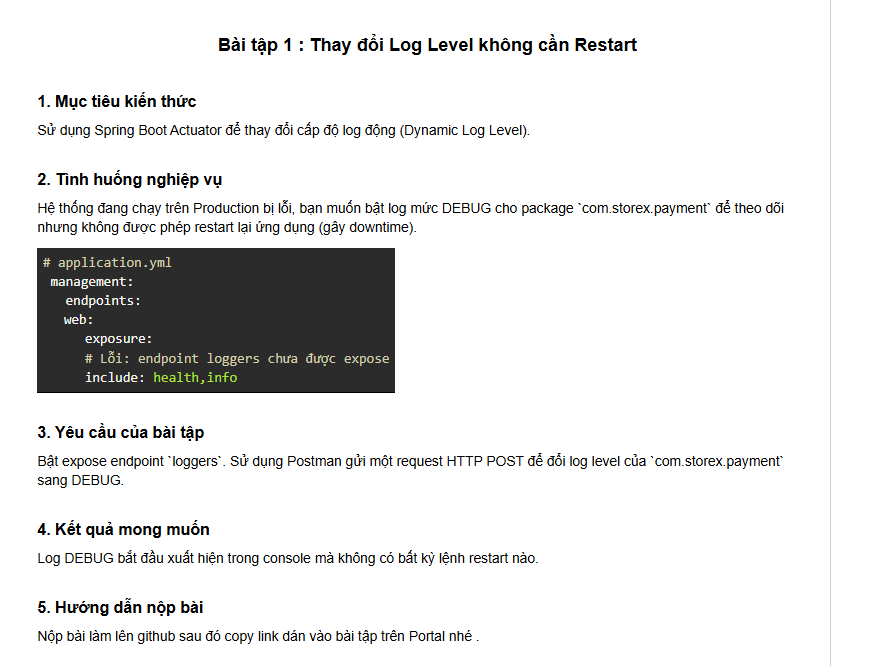

# BÀI TẬP SESSION 18 (MD5) - BÀI TẬP 1 (HW1)
## Thay đổi Log Level không cần Restart (Dynamic Log Level với Spring Boot Actuator)



---

## 1. Mục tiêu kiến thức & Tình huống nghiệp vụ

- **Mục tiêu kiến thức**:
  - Nắm vững cơ chế hoạt động của **Spring Boot Actuator** đối với việc quản trị ứng dụng tại thời gian thực (runtime).
  - Hiểu và triển khai tính năng **Dynamic Log Level (Cấp độ log động)** để điều chỉnh mức độ chi tiết của log (TRACE, DEBUG, INFO, WARN, ERROR) cho từng package/class cụ thể mà **hoàn toàn không cần khởi động lại ứng dụng**.
  - Biết cách expose endpoint `/actuator/loggers` an toàn trong `application.yml` và sử dụng các công cụ như **Postman**, **cURL** để tương tác.

- **Tình huống nghiệp vụ (Production Troubleshooting)**:
  - Một ứng dụng thương mại điện tử **StoreX** đang vận hành trên môi trường Production thì module xử lý thanh toán (`com.storex.payment`) phát sinh lỗi giao dịch không rõ nguyên nhân.
  - Cấu hình log mặc định trên Production là `INFO` để tiết kiệm tài nguyên CPU và dung lượng ổ cứng, do đó các thông tin chi tiết (request payload, trạng thái kết nối socket tới cổng đối tác, mã đối soát...) ở mức `DEBUG` không được ghi nhận.
  - **Ràng buộc nghiêm ngặt**: Không được phép restart lại ứng dụng vì sẽ làm gián đoạn hàng ngàn phiên giao dịch đang diễn ra của khách hàng (downtime).
  - **Giải pháp**: Kích hoạt endpoint `loggers` của Spring Boot Actuator và gửi một HTTP request để chuyển động log level của package `com.storex.payment` sang `DEBUG`.

---

## 2. Phân tích Nguyên lý Hoạt động (Dynamic Log Level)

### 2.1. Cơ chế bên dưới của Spring Boot Actuator

Khi ứng dụng Spring Boot khởi chạy với logging framework (mặc định là **Logback** kết hợp với **SLF4J**):
1. Cấu hình ban đầu được đọc từ `application.yml` và nạp vào đối tượng `LoggingSystem` (cụ thể là `LogbackLoggingSystem`) trong JVM RAM.
2. Endpoint `/actuator/loggers` được quản lý bởi bean `LoggersEndpoint` trong thư viện `spring-boot-actuator`.
3. Khi nhận request `POST /actuator/loggers/{name}`, Actuator gọi `loggingSystem.setLogLevel(name, level)`:
   - Thao tác này sửa trực tiếp trạng thái cấu hình của Logger object trong bộ nhớ (**in-memory**) của JVM.
   - **Không cần đọc lại file cấu hình đĩa, không cần reload Spring Context, không cần restart tiến trình Java**.
   - Mọi log statement (`log.debug(...)`) được gọi ngay sau tích tắc đó sẽ được đánh giá theo cấp độ mới.

```
+-----------------------------------------------------------------------------------------+
|                                    JVM RUNTIME (StoreX)                                 |
|                                                                                         |
|   1. Ban đầu: com.storex.payment (Level = INFO)                                         |
|      log.info(...)  ==> IN RA CONSOLE                                                   |
|      log.debug(...) ==> BỊ BỎ QUA (Không in)                                            |
|                                                                                         |
|   2. Nhận HTTP POST: /actuator/loggers/com.storex.payment {"configuredLevel": "DEBUG"}  |
|      ┌───────────────┐        ┌───────────────────┐        ┌─────────────────────────┐  |
|      │ Postman / cURL│ ─────► │  LoggersEndpoint  │ ─────► │ Logback `LoggingSystem` │  |
|      └───────────────┘        └───────────────────┘        └───────────┬─────────────┘  |
|                                                                        │ In-Memory      |
|                                                                        ▼                |
|   3. Ngay lập tức: com.storex.payment (Level = DEBUG) ◄────────────────┘                |
|      log.info(...)  ==> IN RA CONSOLE                                                   |
|      log.debug(...) ==> LẬP TỨC IN RA CONSOLE (Không cần restart!)                      |
+-----------------------------------------------------------------------------------------+
```

### 2.2. Phân biệt `configuredLevel` và `effectiveLevel`
Khi truy vấn endpoint `GET /actuator/loggers/{name}`, Actuator trả về hai trường:
- **`configuredLevel`**: Cấp độ log được cấu hình tường minh cho logger này (ví dụ: `DEBUG`, `INFO`). Nếu logger này không được cấu hình riêng mà kế thừa từ cha, trường này sẽ là `null`.
- **`effectiveLevel`**: Cấp độ log thực tế đang có hiệu lực áp dụng cho logger này (kế thừa từ logger cha hoặc `ROOT` nếu không được set riêng).

---

## 3. Cấu trúc Dự án

```
ss18/
├── .gitignore                                    # Cấu hình bỏ qua target, IDE, logs
├── pom.xml                                       # Khai báo Spring Boot 3.3.4 & Actuator
├── README.md                                     # Tài liệu hướng dẫn & báo cáo chi tiết
├── ss18-1.png                                    # Ảnh chụp màn hình đề bài
├── Session18_HW1_Loggers.postman_collection.json # Bộ sưu tập Postman dựng sẵn
└── src/
    ├── main/
    │   ├── java/
    │   │   └── com/
    │   │       └── storex/
    │   │           └── payment/
    │   │               ├── PaymentApplication.java       # Main Spring Boot Class
    │   │               ├── controller/
    │   │               │   └── PaymentController.java    # REST API thanh toán & demo log
    │   │               └── service/
    │   │                   └── PaymentService.java       # Business logic sinh log INFO & DEBUG
    │   └── resources/
    │       └── application.yml                           # Cấu hình Actuator expose endpoint loggers
    └── test/
        └── java/
            └── com/
                └── storex/
                    └── payment/
                        └── PaymentApplicationTests.java  # Integration test tự động xác thực
```

---

## 4. Chi tiết Cấu hình & Mã nguồn

### 4.1. File `pom.xml`
Bao gồm dependency cần thiết:
```xml
<!-- Spring Boot Web Starter -->
<dependency>
    <groupId>org.springframework.boot</groupId>
    <artifactId>spring-boot-starter-web</artifactId>
</dependency>

<!-- Spring Boot Actuator Starter: Hỗ trợ giám sát & Dynamic Log Level -->
<dependency>
    <groupId>org.springframework.boot</groupId>
    <artifactId>spring-boot-starter-actuator</artifactId>
</dependency>
```

### 4.2. File cấu hình `application.yml`
Khắc phục lỗi ban đầu bằng cách bổ sung `loggers` vào danh sách `exposure.include`:

```yaml
server:
  port: 8080

spring:
  application:
    name: storex-payment-service

# Cấu hình logging ban đầu: package com.storex.payment ở mức INFO
logging:
  level:
    root: INFO
    com.storex.payment: INFO
  pattern:
    console: "%d{yyyy-MM-dd HH:mm:ss.SSS} [%thread] %highlight(%-5level) %cyan(%logger{36}) - %msg%n"

# Cấu hình Spring Boot Actuator
management:
  endpoints:
    web:
      exposure:
        # BẬT EXPOSE ENDPOINT loggers theo đúng yêu cầu đề bài
        include: health, info, loggers
  endpoint:
    loggers:
      enabled: true
    health:
      show-details: always
```

### 4.3. Module nghiệp vụ `com.storex.payment`
- **`PaymentService.java`**:
  ```java
  @Service
  public class PaymentService {
      private static final Logger log = LoggerFactory.getLogger(PaymentService.class);

      public Map<String, Object> processPayment(String orderId, double amount, String customerId, String gateway) {
          // Luôn hiển thị khi ở mức INFO
          log.info("[INFO] Nhận yêu cầu xử lý thanh toán cho đơn hàng: orderId={}, amount={} USD", orderId, amount);

          // Chỉ hiển thị khi cấp độ log được nâng lên DEBUG qua Actuator
          log.debug("[DEBUG] Bắt đầu xác thực thông tin khách hàng: customerId={}", customerId);
          log.debug("[DEBUG] Kiểm tra số dư và hạn mức thanh toán với cổng: gateway={}", gateway);
          
          String transactionId = "TXN-" + UUID.randomUUID().toString().substring(0, 8).toUpperCase();
          log.debug("[DEBUG] Sinh mã giao dịch nội bộ: transactionId={}", transactionId);
          log.debug("[DEBUG] Đang kết nối tới cổng thanh toán đối tác {} qua giao thức bảo mật...", gateway);

          Map<String, Object> response = new HashMap<>();
          response.put("orderId", orderId);
          response.put("transactionId", transactionId);
          response.put("status", "SUCCESS");
          // ...
          log.info("[INFO] Xử lý thanh toán thành công cho đơn hàng: orderId={}, transactionId={}", orderId, transactionId);
          return response;
      }
  }
  ```

---

## 5. Hướng dẫn Kiểm thử Thực tế Từng bước

### Bước 1: Khởi động Ứng dụng
Mở terminal tại thư mục dự án và chạy lệnh:
```bash
mvn spring-boot:run
```
Console sẽ ghi nhận ứng dụng khởi chạy thành công trên cổng 8080:
```
Exposing 3 endpoints beneath base path '/actuator'
Tomcat started on port 8080 (http) with context path '/'
Started PaymentApplication in 1.699 seconds
```

---

### Bước 2: Kiểm tra Log Level ban đầu của `com.storex.payment`
Gửi HTTP GET đến Actuator:
- **URL**: `http://localhost:8080/actuator/loggers/com.storex.payment`
- **Method**: `GET`

**Response trả về**:
```json
{
  "configuredLevel": "INFO",
  "effectiveLevel": "INFO"
}
```

---

### Bước 3: Gọi thử API thanh toán (Trước khi đổi Log Level)
Gửi HTTP GET đến API test:
- **URL**: `http://localhost:8080/api/payments/test`
- **Method**: `GET`

**Quan sát Console**:
```text
2026-09-28 11:03:36.602 [http-nio-8080-exec-2] INFO  c.s.p.controller.PaymentController - [INFO] [PaymentController] Nhận request GET /api/payments/test
2026-09-28 11:03:36.610 [http-nio-8080-exec-2] INFO  c.s.payment.service.PaymentService - [INFO] Nhận yêu cầu xử lý thanh toán cho đơn hàng: orderId=ORD-8888, amount=250.75 USD
2026-09-28 11:03:36.613 [http-nio-8080-exec-2] INFO  c.s.payment.service.PaymentService - [INFO] Xử lý thanh toán thành công cho đơn hàng: orderId=ORD-8888, transactionId=TXN-E7053DF8
```
> **Nhận xét**: Chỉ có các dòng log `[INFO]` xuất hiện. Các dòng log `[DEBUG]` chi tiết hoàn toàn bị ẩn vì log level hiện tại là `INFO`.

---

### Bước 4: [YÊU CẦU CHÍNH] Đổi Log Level sang DEBUG bằng Postman / cURL
Gửi HTTP POST request để thay đổi log level mà **không restart ứng dụng**:

#### Thao tác trên Postman:
1. **Method**: `POST`
2. **URL**: `http://localhost:8080/actuator/loggers/com.storex.payment`
3. **Headers**:
   - `Content-Type`: `application/json`
4. **Body** (chọn `raw` -> `JSON`):
   ```json
   {
       "configuredLevel": "DEBUG"
   }
   ```
5. Nhấn **Send**.

#### Lệnh cURL tương đương:
```bash
curl -X POST http://localhost:8080/actuator/loggers/com.storex.payment \
     -H "Content-Type: application/json" \
     -d '{"configuredLevel": "DEBUG"}'
```

#### PowerShell tương đương:
```powershell
Invoke-RestMethod -Uri "http://localhost:8080/actuator/loggers/com.storex.payment" -Method Post -ContentType "application/json" -Body '{"configuredLevel":"DEBUG"}'
```

**Kết quả trả về**:
- HTTP Status Code: **`204 No Content`** (Thành công - cấu hình đã được cập nhật trực tiếp vào bộ nhớ JVM).

---

### Bước 5: Xác nhận Log Level đã chuyển sang DEBUG
Gửi lại HTTP GET:
- **URL**: `http://localhost:8080/actuator/loggers/com.storex.payment`
- **Method**: `GET`

**Response trả về**:
```json
{
  "configuredLevel": "DEBUG",
  "effectiveLevel": "DEBUG"
}
```

---

### Bước 6: [KẾT QUẢ MONG MUỐN] Gọi lại API thanh toán và quan sát Console
Gửi lại HTTP GET đến API test:
- **URL**: `http://localhost:8080/api/payments/test`
- **Method**: `GET`

**Console lập tức xuất hiện các dòng log DEBUG mà không hề có thao tác restart nào**:
```text
2026-09-28 11:04:08.549 [http-nio-8080-exec-2] INFO  c.s.p.controller.PaymentController - [INFO] [PaymentController] Nhận request GET /api/payments/test
2026-09-28 11:04:08.549 [http-nio-8080-exec-2] DEBUG c.s.p.controller.PaymentController - [DEBUG] [PaymentController] Controller debug log: Chuẩn bị gọi PaymentService.processPayment
2026-09-28 11:04:08.550 [http-nio-8080-exec-2] INFO  c.s.payment.service.PaymentService - [INFO] Nhận yêu cầu xử lý thanh toán cho đơn hàng: orderId=ORD-8888, amount=250.75 USD
2026-09-28 11:04:08.550 [http-nio-8080-exec-2] DEBUG c.s.payment.service.PaymentService - [DEBUG] Bắt đầu xác thực thông tin khách hàng: customerId=CUST-1001
2026-09-28 11:04:08.550 [http-nio-8080-exec-2] DEBUG c.s.payment.service.PaymentService - [DEBUG] Kiểm tra số dư và hạn mức thanh toán với cổng: gateway=VNPay
2026-09-28 11:04:08.551 [http-nio-8080-exec-2] DEBUG c.s.payment.service.PaymentService - [DEBUG] Sinh mã giao dịch nội bộ: transactionId=TXN-25820A04
2026-09-28 11:04:08.551 [http-nio-8080-exec-2] DEBUG c.s.payment.service.PaymentService - [DEBUG] Đang kết nối tới cổng thanh toán đối tác VNPay qua giao thức bảo mật...
2026-09-28 11:04:08.551 [http-nio-8080-exec-2] INFO  c.s.payment.service.PaymentService - [INFO] Xử lý thanh toán thành công cho đơn hàng: orderId=ORD-8888, transactionId=TXN-25820A04
2026-09-28 11:04:08.551 [http-nio-8080-exec-2] DEBUG c.s.p.controller.PaymentController - [DEBUG] [PaymentController] Controller debug log: Kết quả trả về từ PaymentService -> status: SUCCESS
```

> **Minh chứng**: Các dòng log `DEBUG` của package `com.storex.payment` đã hiển thị chi tiết theo thời gian thực (runtime) mà **không cần khởi động lại ứng dụng**, giải quyết trọn vẹn yêu cầu bài toán đặt ra!

---

### Bước 7: Khôi phục Log Level về INFO sau khi trace xong sự cố
Sau khi điều tra xong lỗi trên Production, cần đưa log level trở lại `INFO` để giải phóng dung lượng đĩa và tài nguyên xử lý:
```bash
curl -X POST http://localhost:8080/actuator/loggers/com.storex.payment \
     -H "Content-Type: application/json" \
     -d '{"configuredLevel": "INFO"}'
```

---

## 6. Hướng dẫn Sử dụng File Postman Collection
Dự án đã đính kèm sẵn file **`Session18_HW1_Loggers.postman_collection.json`**:
1. Mở ứng dụng **Postman**.
2. Nhấn nút **Import** ở góc trên bên trái.
3. Kéo thả file `Session18_HW1_Loggers.postman_collection.json` vào.
4. Chạy tuần tự các request từ `01` đến `07` đã được sắp xếp sẵn theo đúng kịch bản bài tập.

---

## 7. Kiểm thử Tự động (Automated Verification)
Dự án đi kèm integration test tự động `PaymentApplicationTests.java` sử dụng MockMvc kiểm thử toàn bộ vòng đời thay đổi log level:
```bash
mvn clean test
```
**Kết quả kiểm thử**:
```text
[INFO] Running com.storex.payment.PaymentApplicationTests
[INFO] Tests run: 2, Failures: 0, Errors: 0, Skipped: 0
[INFO] BUILD SUCCESS
```

---

## 8. Kết luận
- Tính năng **Dynamic Log Level** của Spring Boot Actuator là công cụ đắc lực trong vận hành hệ thống thực tế (DevOps / SRE):
  1. Cho phép bật/tắt log mức sâu (`DEBUG`/`TRACE`) có mục tiêu cho đúng package đang gặp sự cố.
  2. Không gây gián đoạn dịch vụ (Zero Downtime).
  3. Tiết kiệm tài nguyên và kiểm soát dung lượng log an toàn trên Production.
