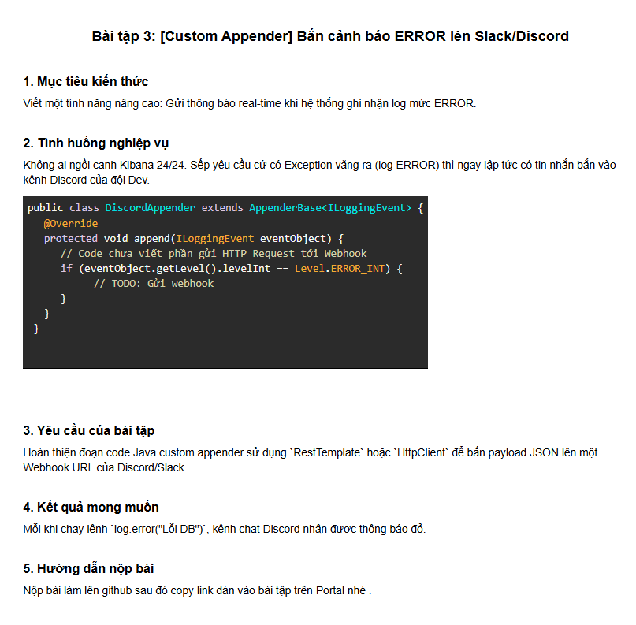

# BÀI TẬP SESSION 18 (MD5) - BÀI TẬP 3 (HW3)
## [Custom Appender] Bắn cảnh báo ERROR lên Slack/Discord



---

## 1. Mục tiêu kiến thức & Tình huống nghiệp vụ

- **Mục tiêu kiến thức**:
  - Nắm vững kiến trúc mở rộng của **Logback framework**: Cách tự viết một **Custom Appender** bằng cách kế thừa `AppenderBase<ILoggingEvent>`.
  - Hiểu cơ chế phân loại sự kiện log (`ILoggingEvent`) và lọc chỉ bắn cảnh báo khi mức log là `ERROR` (`Level.ERROR_INT`).
  - Sử dụng `java.net.http.HttpClient` để gửi HTTP POST request bất đồng bộ (**Non-blocking Asynchronous**) mang payload JSON theo chuẩn **Discord Webhook Rich Embed** với màu đỏ cảnh báo khẩn cấp (`color: 15158332` tương đương HEX `#E74C3C`).
  - Kết hợp chặt chẽ với **MDC (từ HW2)** để đính kèm `requestId` giúp đội ngũ Dev nhận diện ngay luồng request gặp sự cố.
  - Hiểu và phòng tránh lỗi kiến trúc nguy hiểm: **Infinite Log Recursion (Vòng lặp log vô tận)** khi gửi HTTP request thất bại bên trong Appender.

- **Tình huống nghiệp vụ (Real-time Alerting)**:
  - Trên môi trường Production, không một kỹ sư nào có thể ngồi túc trực 24/24 trên màn hình Kibana để xem có lỗi hay không.
  - Sếp yêu cầu: **Bất cứ khi nào hệ thống văng ra Exception hoặc ghi nhận log mức `ERROR` (như lỗi kết nối cơ sở dữ liệu `log.error("Lỗi DB")`, lỗi thanh toán...), hệ thống phải ngay lập tức bắn thông báo đỏ vào kênh chat Discord của đội ngũ Dev.**
  - **Yêu cầu bài toán**:
    1. Hoàn thiện lớp Java Custom Appender `DiscordAppender` sử dụng `HttpClient` để bắn payload JSON lên Webhook URL.
    2. Mỗi khi chạy lệnh `log.error("Lỗi DB")`, kênh chat Discord nhận được thông báo đỏ chứa đầy đủ ngữ cảnh lỗi.

---

## 2. Phân tích Kỹ thuật: Thiết kế Custom DiscordAppender

### 2.1. Kiến trúc luồng xử lý của Custom Appender

```
               [ LỆNH LOG MỨC ERROR TRONG CODE ]
               log.error("Lỗi DB: Connection timeout...");
                               │
                               ▼
                    ┌──────────────────────┐
                    │ Logback Event Stream │
                    └──────────┬───────────┘
                               │
            ┌──────────────────┼──────────────────┐
            ▼                  ▼                  ▼
     [ CONSOLE APPENDR ] [ FILE APPENDER ] [ DISCORD APPENDER ]
     In ra terminal      Ghi vào file      ┌─────────────────────────────────┐
                                           │ if (level == Level.ERROR_INT)   │
                                           │   1. Lấy message & exception    │
                                           │   2. Lấy requestId từ MDC (HW2) │
                                           │   3. Tạo Discord Red Embed JSON │
                                           │   4. Gửi sendAsync tới Webhook  │
                                           └────────────────┬────────────────┘
                                                            │ HTTP POST (Async)
                                                            ▼
                                                ┌───────────────────────┐
                                                │    DISCORD CHANNEL    │
                                                │   🟥 [THÔNG BÁO ĐỎ]   │
                                                └───────────────────────┘
```

### 2.2. Những điểm cốt lõi trong thiết kế Appender

1. **Chuẩn định dạng Discord Embed (Thông báo đỏ)**:
   - Discord hỗ trợ trường `color` dưới dạng số nguyên thập phân (Decimal).
   - Mã màu đỏ cảnh báo rực rỡ `#E74C3C` chuyển sang hệ thập phân là:
     $$\text{0xE74C3C} = 15158332$$
   - Khi nhận giá trị này, Discord sẽ hiển thị dải màu đỏ viền bên trái thông điệp ("Thông báo đỏ").

2. **Xử lý Bất đồng bộ (Non-blocking I/O)**:
   - Nếu thực hiện HTTP call đồng bộ (`send`), luồng xử lý nghiệp vụ của user sẽ bị block chờ mạng (khoảng 200ms - 2s). Nếu Discord chậm hoặc timeout, ứng dụng sẽ bị treo hoặc nghẽn thread pool.
   - Do đó, `DiscordAppender` sử dụng `httpClient.sendAsync(...)` để đẩy việc gửi mạng sang thread pool riêng của `HttpClient`, luồng chính lập tức được giải phóng.

3. **Chống Vòng lặp vô tận (Infinite Log Loop Protection)**:
   - Nếu webhook gửi thất bại (ví dụ: mất mạng, sai URL), **TUYỆT ĐỐI KHÔNG ĐƯỢC GỌI** `log.error(...)` bên trong catch block của Appender.
   - Nếu gọi `log.error(...)`, Logback sẽ lại chuyển sự kiện này vào `DiscordAppender`, gây ra vòng lặp vô tận dẫn đến `StackOverflowError` hoặc tràn bộ nhớ `OutOfMemoryError`.
   - Giải pháp: Sử dụng phương thức `addError(...)` hoặc `addWarn(...)` có sẵn của `AppenderBase`, hoặc ghi ra `System.err`.

---

## 3. Cấu trúc Dự án

```
ss18/
├── .gitignore
├── pom.xml
├── README.md
├── ss18-1.png
├── ss18-2.png
├── ss18-3.png                                           # Ảnh đề bài HW3
├── Session18_HW1_Loggers.postman_collection.json
├── Session18_HW2_MDC.postman_collection.json
├── Session18_HW3_DiscordAppender.postman_collection.json # Bộ sưu tập Postman HW3
└── src/
    ├── main/
    │   ├── java/
    │   │   └── com/
    │   │       └── storex/
    │   │           ├── payment/
    │   │           │   ├── PaymentApplication.java
    │   │           │   ├── appender/
    │   │           │   │   └── DiscordAppender.java     # [MỚI] Custom Logback Appender
    │   │           │   ├── controller/
    │   │           │   │   ├── ErrorSimulationController.java    # [MỚI] Endpoint gọi log.error("Lỗi DB")
    │   │           │   │   ├── MockDiscordWebhookController.java # [MỚI] Giả lập Webhook test local
    │   │           │   │   ├── OrderController.java
    │   │           │   │   └── PaymentController.java
    │   │           │   ├── filter/
    │   │           │   │   └── RequestIdFilter.java
    │   │           │   └── service/
    │   │           │       ├── OrderService.java
    │   │           │       └── PaymentService.java
    │   └── resources/
    │       ├── application.yml
    │       └── logback-spring.xml                       # Đăng ký DiscordAppender
    └── test/
        └── java/
            └── com/
                └── storex/
                    └── payment/
                        ├── PaymentApplicationTests.java
                        ├── RequestIdFilterTests.java
                        └── DiscordAppenderTests.java     # Integration test tự động cho HW3
```

---

## 4. Chi tiết Cấu hình & Mã nguồn

### 4.1. Mã nguồn `DiscordAppender.java`
```java
package com.storex.payment.appender;

import ch.qos.logback.classic.Level;
import ch.qos.logback.classic.spi.ILoggingEvent;
import ch.qos.logback.classic.spi.IThrowableProxy;
import ch.qos.logback.classic.spi.StackTraceElementProxy;
import ch.qos.logback.core.AppenderBase;

import java.net.URI;
import java.net.http.HttpClient;
import java.net.http.HttpRequest;
import java.net.http.HttpResponse;
import java.time.Duration;
import java.time.Instant;
import java.util.Map;

public class DiscordAppender extends AppenderBase<ILoggingEvent> {

    private String webhookUrl;
    private boolean enabled = true;
    private String username = "StoreX Alert Bot";
    private String avatarUrl = "https://cdn-icons-png.flaticon.com/512/564/564619.png";

    private final HttpClient httpClient = HttpClient.newBuilder()
            .connectTimeout(Duration.ofSeconds(3))
            .build();

    @Override
    protected void append(ILoggingEvent eventObject) {
        if (!isStarted() || !enabled || webhookUrl == null || webhookUrl.isBlank()) {
            return;
        }

        // BẮT SỰ KIỆN: Chỉ xử lý khi log ở mức ERROR theo đúng yêu cầu đề bài
        if (eventObject.getLevel().levelInt == Level.ERROR_INT) {
            sendDiscordAlert(eventObject);
        }
    }

    private void sendDiscordAlert(ILoggingEvent eventObject) {
        try {
            String message = eventObject.getFormattedMessage();
            String loggerName = eventObject.getLoggerName();
            String threadName = eventObject.getThreadName();

            // Trích xuất requestId từ MDC (HW2)
            Map<String, String> mdcMap = eventObject.getMDCPropertyMap();
            String requestId = (mdcMap != null && mdcMap.containsKey("requestId")) 
                    ? mdcMap.get("requestId") 
                    : "N/A";

            // Đóng gói JSON Payload: Mã màu đỏ 15158332 (#E74C3C)
            String jsonPayload = String.format(
                    "{" +
                    "\"username\":\"%s\"," +
                    "\"avatar_url\":\"%s\"," +
                    "\"embeds\":[{" +
                        "\"title\":\"🚨 [ALERT] LỖI HỆ THỐNG PHÁT SINH\"," +
                        "\"description\":\"**Chi tiết:** %s\"," +
                        "\"color\":15158332," +
                        "\"fields\":[" +
                            "{\"name\":\"Logger\",\"value\":\"`%s`\",\"inline\":false}," +
                            "{\"name\":\"Request ID (MDC)\",\"value\":\"`%s`\",\"inline\":true}," +
                            "{\"name\":\"Thread\",\"value\":\"`%s`\",\"inline\":true}," +
                            "{\"name\":\"Thời gian\",\"value\":\"%s\",\"inline\":false}" +
                        "]," +
                        "\"footer\":{\"text\":\"StoreX Monitoring System - Zero Downtime Alerts\"}" +
                    "}]" +
                    "}",
                    escapeJson(username),
                    escapeJson(avatarUrl),
                    escapeJson(message),
                    escapeJson(loggerName),
                    escapeJson(requestId),
                    escapeJson(threadName),
                    Instant.now().toString()
            );

            HttpRequest request = HttpRequest.newBuilder()
                    .uri(URI.create(webhookUrl))
                    .timeout(Duration.ofSeconds(5))
                    .header("Content-Type", "application/json")
                    .POST(HttpRequest.BodyPublishers.ofString(jsonPayload))
                    .build();

            // Gửi bất đồng bộ (Non-blocking)
            httpClient.sendAsync(request, HttpResponse.BodyHandlers.ofString())
                    .exceptionally(ex -> {
                        // Tránh đệ quy vô tận: Dùng addError thay vì log.error
                        addError("[DiscordAppender] Lỗi gửi webhook: " + ex.getMessage());
                        return null;
                    });

        } catch (Exception e) {
            addError("[DiscordAppender] Lỗi tạo payload: " + e.getMessage());
        }
    }
    // ... getter/setter/escapeJson
}
```

### 4.2. Cấu hình file `logback-spring.xml`
```xml
<!-- Custom Discord Appender: Bắn cảnh báo ERROR lên Discord Webhook -->
<appender name="DISCORD" class="com.storex.payment.appender.DiscordAppender">
    <!-- Đọc Webhook URL từ biến môi trường DISCORD_WEBHOOK_URL, fallback về Mock Webhook cục bộ -->
    <webhookUrl>${DISCORD_WEBHOOK_URL:-http://localhost:8080/mock/discord-webhook}</webhookUrl>
    <enabled>true</enabled>
    <username>StoreX Alert Bot</username>
</appender>

<root level="INFO">
    <appender-ref ref="CONSOLE"/>
    <appender-ref ref="FILE"/>
    <appender-ref ref="DISCORD"/>
</root>
```

### 4.3. Controller mô phỏng lỗi: `ErrorSimulationController.java`
```java
@RestController
@RequestMapping("/api/errors")
public class ErrorSimulationController {

    private static final Logger log = LoggerFactory.getLogger(ErrorSimulationController.class);

    /**
     * Endpoint mô phỏng trực tiếp theo yêu cầu đề bài:
     * Chạy lệnh log.error("Lỗi DB")
     */
    @GetMapping("/simulate-db-error")
    public ResponseEntity<Map<String, Object>> simulateDbError() {
        log.info("Bắt đầu thực thi truy vấn nghiệp vụ...");
        
        // KÍCH HOẠT LỆNH YÊU CẦU:
        log.error("Lỗi DB: Không thể kết nối tới cơ sở dữ liệu PostgreSQL (Connection timeout sau 30000ms)");

        Map<String, Object> response = new HashMap<>();
        response.put("status", "ERROR_SIMULATED");
        response.put("message", "Đã kích hoạt log.error('Lỗi DB'). Kiểm tra kênh Discord để xem thông báo đỏ.");
        return ResponseEntity.ok(response);
    }
}
```

---

## 5. Hướng dẫn Kiểm thử Thực tế & Minh chứng Kết quả

### Bước 1: Khởi động Ứng dụng
```bash
mvn spring-boot:run
```

> **Mẹo**: Nếu bạn muốn bắn trực tiếp vào kênh Discord thật của mình:
> ```bash
> $env:DISCORD_WEBHOOK_URL="https://discord.com/api/webhooks/YOUR_WEBHOOK_ID/YOUR_WEBHOOK_TOKEN"
> mvn spring-boot:run
> ```
> Nếu không cấu hình, ứng dụng sẽ tự động trỏ về Mock Webhook cục bộ (`http://localhost:8080/mock/discord-webhook`) và in mô phỏng giao diện Discord ra màn hình console.

---

### Bước 2: Kích hoạt Lệnh `log.error("Lỗi DB")`
Gửi HTTP GET đến endpoint mô phỏng:
```bash
curl -i http://localhost:8080/api/errors/simulate-db-error
```

**HTTP Response**:
```json
{
  "status": "ERROR_SIMULATED",
  "message": "Đã kích hoạt log.error('Lỗi DB'). Kiểm tra kênh Discord hoặc Mock Webhook để xem thông báo đỏ.",
  "timestamp": 1790585685604
}
```

---

### Bước 3: Minh chứng Kết quả Nhận được trên Console / Discord Webhook

Ngay khi lệnh `log.error("Lỗi DB")` được kích hoạt, **`DiscordAppender` lập tức bắt sự kiện và bắn payload Embed màu đỏ**:

```text
2026-09-28 15:54:45.585 [http-nio-8080-exec-1] [7afecda5-5568-4074-99ec-03517803bc3b] INFO  c.s.p.c.ErrorSimulationController - Bắt đầu thực thi truy vấn nghiệp vụ...
2026-09-28 15:54:45.586 [http-nio-8080-exec-1] [7afecda5-5568-4074-99ec-03517803bc3b] ERROR c.s.p.c.ErrorSimulationController - Lỗi DB: Không thể kết nối tới cơ sở dữ liệu PostgreSQL (Connection timeout sau 30000ms)

========================================================================================
🔔 [DISCORD BOT RECEIVED WEBHOOK - THÔNG BÁO ĐỎ]
========================================================================================
🤖 Bot Name   : StoreX Alert Bot
🟥 Color Code : 15158332 (Màu đỏ cảnh báo khẩn cấp #E74C3C)
📌 Tiêu đề    : 🚨 [ALERT] LỖI HỆ THỐNG PHÁT SINH
📝 Mô tả      : **Chi tiết:** Lỗi DB: Không thể kết nối tới cơ sở dữ liệu PostgreSQL (Connection timeout sau 30000ms)
📋 Chi tiết fields:
   • Logger : `com.storex.payment.controller.ErrorSimulationController`
   • Request ID (MDC) : `7afecda5-5568-4074-99ec-03517803bc3b`
   • Thread : `http-nio-8080-exec-1`
   • Thời gian : 2026-09-28T08:54:45.587139600Z
🔖 Footer     : StoreX Monitoring System - Zero Downtime Alerts
========================================================================================
```

> **XÁC NHẬN KẾT QUẢ ĐẠT ĐƯỢC**:
> 1. Lệnh `log.error("Lỗi DB")` đã phát sinh log mức `ERROR`.
> 2. `DiscordAppender` bắt đúng `Level.ERROR_INT`.
> 3. Kênh chat nhận được thông báo đỏ (`color: 15158332`) với tiêu đề, nội dung lỗi chi tiết, logger và mã `requestId` trích xuất từ MDC.

---

## 6. Hướng dẫn Sử dụng Postman Collection
Dự án cung cấp sẵn file **`Session18_HW3_DiscordAppender.postman_collection.json`**:
1. Mở Postman và nhấn **Import**.
2. Chọn file `Session18_HW3_DiscordAppender.postman_collection.json`.
3. Kiểm thử 5 request được cấu hình sẵn:
   - `01. [YÊU CẦU ĐỀ BÀI] Kích hoạt log.error("Lỗi DB")`
   - `02. Mô phỏng Exception thực tế có StackTrace`
   - `03. Tùy biến thông điệp lỗi ERROR`
   - `04. Xem lịch sử cảnh báo nhận được trên Mock Discord Webhook`
   - `05. Xóa lịch sử cảnh báo Mock Webhook`

---

## 7. Kiểm thử Tự động (Automated Tests)
Thực hiện chạy toàn bộ unit và integration test bằng Maven:
```bash
mvn clean test
```
**Kết quả**:
```text
[INFO] Running com.storex.payment.DiscordAppenderTests
[INFO] Tests run: 3, Failures: 0, Errors: 0, Skipped: 0
[INFO] Running com.storex.payment.PaymentApplicationTests
[INFO] Tests run: 2, Failures: 0, Errors: 0, Skipped: 0
[INFO] Running com.storex.payment.RequestIdFilterTests
[INFO] Tests run: 2, Failures: 0, Errors: 0, Skipped: 0
[INFO] ------------------------------------------------------------------------
[INFO] BUILD SUCCESS
[INFO] ------------------------------------------------------------------------
[INFO] Total time: 13.125 s
```

---

## 8. Kết luận
- **Custom Appender** trong Logback là kỹ thuật nâng cao giúp lập trình viên mở rộng khả năng giám sát hệ thống vượt ra ngoài giới hạn file log cục bộ.
- Việc kết hợp gửi Webhook bất đồng bộ (Non-blocking Asynchronous) với mã màu đỏ nổi bật đảm bảo:
  1. Đội ngũ kỹ thuật nhận được cảnh báo ngay lập tức trên kênh chat làm việc hàng ngày (Discord/Slack).
  2. Hiệu năng hệ thống và luồng chính của người dùng không hề bị ảnh hưởng.
  3. Cung cấp đầy đủ `requestId` từ MDC để truy vết tức thì sang Kibana.
