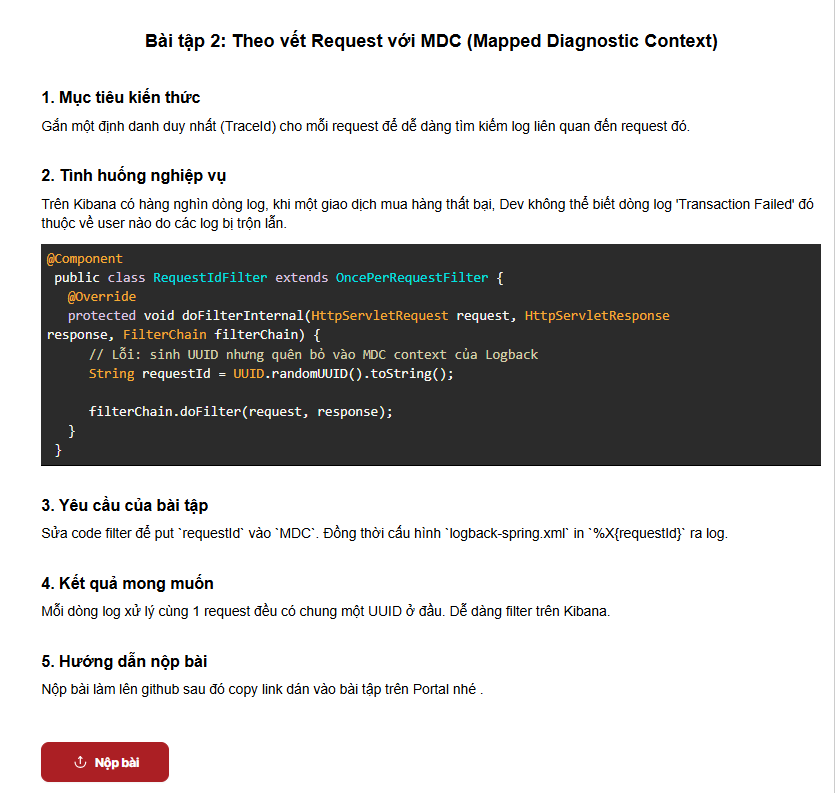

# BÀI TẬP SESSION 18 (MD5) - BÀI TẬP 2 (HW2)
## Theo vết Request với MDC (Mapped Diagnostic Context) trong Spring Boot & Logback



---

## 1. Mục tiêu kiến thức & Tình huống nghiệp vụ

- **Mục tiêu kiến thức**:
  - Hiểu rõ cơ chế hoạt động của **MDC (Mapped Diagnostic Context)** trong SLF4J / Logback: Quản lý thông tin ngữ cảnh theo từng Thread (dựa trên `ThreadLocal`).
  - Biết cách gắn định danh duy nhất (**TraceId / RequestId**) cho mỗi HTTP request ngay từ tầng Filter đầu vào (`OncePerRequestFilter`).
  - Cấu hình file `logback-spring.xml` để trích xuất và in giá trị từ MDC ra log thông qua cú pháp `%X{requestId}`.
  - Nắm vững nguyên tắc giải phóng tài nguyên trong khối `finally` (`MDC.remove()` / `MDC.clear()`) nhằm tránh rò rỉ ngữ cảnh khi luồng (Thread) được trả về ThreadPool và tái sử dụng (**ThreadLocal Leak**).

- **Tình huống nghiệp vụ (Kibana Log Tracing)**:
  - Hệ thống thương mại điện tử **StoreX** phục vụ hàng nghìn lượt truy cập đồng thời. Log từ tất cả các request được thu thập tập trung lên hệ thống ELK (Elasticsearch - Logstash/Filebeat - Kibana).
  - Khi một giao dịch mua hàng phát sinh lỗi và ghi nhận dòng log:
    ```text
    ERROR c.s.payment.service.OrderService - Transaction Failed: Giao dịch thanh toán thất bại...
    ```
    Đội ngũ kỹ sư không thể xác định dòng lỗi này thuộc về người dùng nào, đơn hàng nào hay request nào, vì hàng trăm dòng log từ các luồng (thread) khác nhau đang bị ghi đan xen liên tục trên Kibana.
  - **Yêu cầu bài toán**:
    1. Sửa lớp `RequestIdFilter` để lưu `requestId` (UUID) vào `MDC`.
    2. Cấu hình `logback-spring.xml` in `%X{requestId}` ra tất cả các dòng log.
    3. Đảm bảo mọi dòng log xử lý cùng 1 request đều có chung một UUID ở đầu, giúp kỹ sư dễ dàng gõ `requestId: "<UUID>"` trên Kibana để lọc toàn bộ hành trình của request đó.

---

## 2. Phân tích Kỹ thuật: MDC & Request Tracing

### 2.1. Phân tích lỗi trong đoạn code ban đầu
Đoạn code trong đề bài:
```java
@Component
public class RequestIdFilter extends OncePerRequestFilter {
    @Override
    protected void doFilterInternal(HttpServletRequest request, HttpServletResponse response, FilterChain filterChain) {
        // Lỗi: sinh UUID nhưng quên bỏ vào MDC context của Logback
        String requestId = UUID.randomUUID().toString();

        filterChain.doFilter(request, response);
    }
}
```
**Nguyên nhân lỗi**:
- Biến `requestId` chỉ là một biến cục bộ trong phương thức `doFilterInternal()`. Sau khi sinh ra, nó không được nạp vào bất kỳ cơ chế context nào.
- Bộ định dạng log của Logback (`PatternLayout`) không có cách nào truy xuất được biến cục bộ này.
- Khi các service bên trong (`OrderService`, `PaymentService`, `PaymentController`) gọi `log.info(...)` hay `log.error(...)`, Logback không tìm thấy `requestId` trong context nên không thể in ra mã truy vết.

### 2.2. Cơ chế hoạt động của Mapped Diagnostic Context (MDC)

```
[ HTTP Request ] ──► (Header: X-Request-Id hoặc sinh mới UUID)
        │
        ▼
┌────────────────────────────────────────────────────────────────────────┐
│  RequestIdFilter (OncePerRequestFilter)                                │
│                                                                        │
│  1. String requestId = UUID.randomUUID().toString();                  │
│  2. MDC.put("requestId", requestId); ──► [ ThreadLocal Context (JVM) ] │
│  3. response.setHeader("X-Request-Id", requestId);                     │
│                                                                        │
│  try {                                                                 │
│      filterChain.doFilter(request, response);                          │
│          ├── OrderController  ──► log.info(...)   ──┐                  │
│          ├── OrderService     ──► log.debug(...)  ──┼──► %X{requestId} │
│          └── PaymentService   ──► log.error(...)  ──┘   Đọc từ MDC!    │
│  } finally {                                                           │
│      MDC.remove("requestId"); // XÓA để tránh ThreadLocal leak!        │
│  }                                                                     │
└────────────────────────────────────────────────────────────────────────┘
```

> **Cảnh báo cực kỳ quan trọng về ThreadPool**:
> Các web server như Tomcat sử dụng ThreadPool để xử lý request. Khi một request kết thúc, thread **không bị hủy** mà được đưa về pool để phục vụ request tiếp theo.
> Nếu không gọi `MDC.remove("requestId")` hoặc `MDC.clear()` trong khối `finally`, `requestId` cũ sẽ lưu lại trên thread đó và bị ghi nhận nhầm vào request của người dùng tiếp theo!

---

## 3. Cấu trúc Dự án

```
ss18/
├── .gitignore
├── pom.xml
├── README.md
├── ss18-1.png
├── ss18-2.png                                    # Ảnh đề bài HW2
├── Session18_HW1_Loggers.postman_collection.json # Collection HW1
├── Session18_HW2_MDC.postman_collection.json     # Collection HW2
└── src/
    ├── main/
    │   ├── java/
    │   │   └── com/
    │   │       └── storex/
    │   │           └── payment/
    │   │               ├── PaymentApplication.java
    │   │               ├── controller/
    │   │               │   ├── OrderController.java    # Controller đặt hàng & mô phỏng lỗi
    │   │               │   └── PaymentController.java  # Controller thanh toán
    │   │               ├── filter/
    │   │               │   └── RequestIdFilter.java    # Filter gán requestId vào MDC
    │   │               └── service/
    │   │                   ├── OrderService.java       # Service phát sinh luồng log chi tiết
    │   │                   └── PaymentService.java     # Service xử lý thanh toán
    │   └── resources/
    │       ├── application.yml                         # Cấu hình Spring Boot & Actuator
    │       └── logback-spring.xml                      # Cấu hình pattern in %X{requestId}
    └── test/
        └── java/
            └── com/
                └── storex/
                    └── payment/
                        ├── PaymentApplicationTests.java
                        └── RequestIdFilterTests.java   # Integration test tự động xác thực MDC
```

---

## 4. Chi tiết Cấu hình & Cài đặt

### 4.1. Mã nguồn Filter chuẩn hóa: `RequestIdFilter.java`
- Đặt thứ tự `@Order(Ordered.HIGHEST_PRECEDENCE)` để chạy đầu tiên.
- Cho phép nhận header `X-Request-Id` từ client/API Gateway (hỗ trợ Distributed Tracing) hoặc tự động sinh UUID mới.
- Luôn dọn dẹp trong khối `finally`:

```java
package com.storex.payment.filter;

import jakarta.servlet.FilterChain;
import jakarta.servlet.ServletException;
import jakarta.servlet.http.HttpServletRequest;
import jakarta.servlet.http.HttpServletResponse;
import org.slf4j.MDC;
import org.springframework.core.Ordered;
import org.springframework.core.annotation.Order;
import org.springframework.stereotype.Component;
import org.springframework.web.filter.OncePerRequestFilter;

import java.io.IOException;
import java.util.UUID;

@Component
@Order(Ordered.HIGHEST_PRECEDENCE)
public class RequestIdFilter extends OncePerRequestFilter {

    public static final String REQUEST_ID_KEY = "requestId";
    public static final String HEADER_REQUEST_ID = "X-Request-Id";

    @Override
    protected void doFilterInternal(HttpServletRequest request,
                                    HttpServletResponse response,
                                    FilterChain filterChain) throws ServletException, IOException {
        // Nhận X-Request-Id từ Gateway hoặc tự sinh UUID duy nhất
        String requestId = request.getHeader(HEADER_REQUEST_ID);
        if (requestId == null || requestId.isBlank()) {
            requestId = UUID.randomUUID().toString();
        }

        // 1. Đưa requestId vào MDC context của Logback
        MDC.put(REQUEST_ID_KEY, requestId);

        // 2. Trả về header X-Request-Id trong response để client tra cứu
        response.setHeader(HEADER_REQUEST_ID, requestId);

        try {
            filterChain.doFilter(request, response);
        } finally {
            // 3. BẮT BUỘC: Giải phóng context để tránh rò rỉ dữ liệu qua ThreadPool
            MDC.remove(REQUEST_ID_KEY);
        }
    }
}
```

### 4.2. Cấu hình file `logback-spring.xml`
In biến `%X{requestId}` ra console và file:

```xml
<?xml version="1.0" encoding="UTF-8"?>
<configuration scan="true" scanPeriod="30 seconds">

    <!-- Mẫu log Console: Chứa %X{requestId} từ MDC (Fallback: SYSTEM nếu log khởi động) -->
    <property name="CONSOLE_LOG_PATTERN"
              value="%d{yyyy-MM-dd HH:mm:ss.SSS} [%thread] %magenta([%X{requestId:-SYSTEM}]) %highlight(%-5level) %cyan(%logger{36}) - %msg%n"/>

    <!-- Mẫu log File: Định dạng chuẩn cho shipper cào lên Elasticsearch/Kibana -->
    <property name="FILE_LOG_PATTERN"
              value="%d{yyyy-MM-dd HH:mm:ss.SSS} [%thread] [%X{requestId:-SYSTEM}] %-5level %logger{36} - %msg%n"/>

    <!-- Console Appender -->
    <appender name="CONSOLE" class="ch.qos.logback.core.ConsoleAppender">
        <encoder class="ch.qos.logback.classic.encoder.PatternLayoutEncoder">
            <pattern>${CONSOLE_LOG_PATTERN}</pattern>
            <charset>UTF-8</charset>
        </encoder>
    </appender>

    <!-- Rolling File Appender (Chuẩn Logback 1.4+ / Spring Boot 3) -->
    <appender name="FILE" class="ch.qos.logback.core.rolling.RollingFileAppender">
        <file>logs/application.log</file>
        <rollingPolicy class="ch.qos.logback.core.rolling.SizeAndTimeBasedRollingPolicy">
            <fileNamePattern>logs/application-%d{yyyy-MM-dd}.%i.log</fileNamePattern>
            <maxFileSize>10MB</maxFileSize>
            <maxHistory>7</maxHistory>
            <totalSizeCap>1GB</totalSizeCap>
        </rollingPolicy>
        <encoder class="ch.qos.logback.classic.encoder.PatternLayoutEncoder">
            <pattern>${FILE_LOG_PATTERN}</pattern>
            <charset>UTF-8</charset>
        </encoder>
    </appender>

    <!-- Logger package nghiệp vụ com.storex -->
    <logger name="com.storex" level="DEBUG" additivity="false">
        <appender-ref ref="CONSOLE"/>
        <appender-ref ref="FILE"/>
    </logger>

    <root level="INFO">
        <appender-ref ref="CONSOLE"/>
        <appender-ref ref="FILE"/>
    </root>

</configuration>
```

---

## 5. Hướng dẫn Kiểm thử Thực tế & Minh chứng Console

### Bước 1: Khởi động Ứng dụng
```bash
mvn spring-boot:run
```

---

### Bước 2: Mô phỏng Giao dịch thất bại (Tình huống đề bài)
Gửi HTTP GET đến endpoint mô phỏng lỗi:
```bash
curl -i http://localhost:8080/api/orders/fail-demo
```

**HTTP Response trả về kèm header `X-Request-Id`**:
```http
HTTP/1.1 200 
X-Request-Id: 834e03de-a290-4bd2-b110-5816f1967870
Content-Type: application/json

{"orderId":"ORD-FAILED-101","message":"Transaction Failed: Payment declined by bank","userId":"USER-KH-8888","status":"FAILED"}
```

**Quan sát Console của ứng dụng**:
```text
2026-09-28 11:35:14.700 [http-nio-8080-exec-3] [834e03de-a290-4bd2-b110-5816f1967870] INFO  c.s.p.controller.OrderController - [OrderController] Thực hiện mô phỏng giao dịch thất bại để test Kibana filter theo requestId
2026-09-28 11:35:14.701 [http-nio-8080-exec-3] [834e03de-a290-4bd2-b110-5816f1967870] INFO  c.s.payment.service.OrderService - [BẮT ĐẦU] Tiếp nhận yêu cầu đặt hàng từ userId=USER-KH-8888, orderId=ORD-FAILED-101, tổng tiền=1200.0 USD
2026-09-28 11:35:14.707 [http-nio-8080-exec-3] [834e03de-a290-4bd2-b110-5816f1967870] WARN  c.s.payment.service.OrderService - Cổng thanh toán báo lỗi: Số dư tài khoản không đủ hoặc thẻ bị khóa!
2026-09-28 11:35:14.708 [http-nio-8080-exec-3] [834e03de-a290-4bd2-b110-5816f1967870] ERROR c.s.payment.service.OrderService - Transaction Failed: Giao dịch thanh toán thất bại cho đơn hàng orderId=ORD-FAILED-101, userId=USER-KH-8888
```

> **KẾT QUẢ ĐẠT ĐƯỢC**:
> - Tất cả 4 dòng log từ `OrderController` đến `OrderService` (từ khi nhận đơn, kiểm tra tài khoản đến khi báo lỗi `Transaction Failed`) **đều mang chung một UUID**:
>   `[834e03de-a290-4bd2-b110-5816f1967870]`
> - Khi tìm kiếm trên **Kibana Discover**, kỹ sư chỉ cần lọc theo điều kiện:
>   ```sql
>   requestId: "834e03de-a290-4bd2-b110-5816f1967870"
>   ```
>   Lập tức toàn bộ chuỗi hành trình và nguyên nhân lỗi của khách hàng `USER-KH-8888` hiện ra đầy đủ, không hề bị lẫn với bất kỳ luồng log của request nào khác!

---

### Bước 3: Kiểm thử Request khác (Đảm bảo mỗi request có UUID độc lập)
Gửi một request khác:
```bash
curl -i http://localhost:8080/api/payments/test
```
**Console hiển thị UUID hoàn toàn mới**:
```text
2026-09-28 11:35:22.858 [http-nio-8080-exec-1] [49dc5966-2e80-4623-abb9-a621d8d3196b] INFO  c.s.p.controller.PaymentController - [INFO] [PaymentController] Nhận request GET /api/payments/test
2026-09-28 11:35:22.859 [http-nio-8080-exec-1] [49dc5966-2e80-4623-abb9-a621d8d3196b] INFO  c.s.payment.service.PaymentService - [INFO] Nhận yêu cầu xử lý thanh toán cho đơn hàng: orderId=ORD-8888, amount=250.75 USD
2026-09-28 11:35:22.861 [http-nio-8080-exec-1] [49dc5966-2e80-4623-abb9-a621d8d3196b] INFO  c.s.payment.service.PaymentService - [INFO] Xử lý thanh toán thành công cho đơn hàng: orderId=ORD-8888, transactionId=TXN-05C3238E
```

---

### Bước 4: Kiểm thử Client/API Gateway truyền sẵn `X-Request-Id`
```bash
curl -i http://localhost:8080/api/orders/fail-demo -H "X-Request-Id: CUSTOM-TRACE-POSTMAN-777"
```
**Console in ra chính xác trace ID tùy chỉnh**:
```text
2026-09-28 11:35:30.531 [http-nio-8080-exec-7] [CUSTOM-TRACE-POSTMAN-777] INFO  c.s.p.controller.OrderController - [OrderController] Thực hiện mô phỏng giao dịch thất bại để test Kibana filter theo requestId
2026-09-28 11:35:30.532 [http-nio-8080-exec-7] [CUSTOM-TRACE-POSTMAN-777] INFO  c.s.payment.service.OrderService - [BẮT ĐẦU] Tiếp nhận yêu cầu đặt hàng từ userId=USER-KH-8888, orderId=ORD-FAILED-101, tổng tiền=1200.0 USD
2026-09-28 11:35:30.532 [http-nio-8080-exec-7] [CUSTOM-TRACE-POSTMAN-777] WARN  c.s.payment.service.OrderService - Cổng thanh toán báo lỗi: Số dư tài khoản không đủ hoặc thẻ bị khóa!
2026-09-28 11:35:30.532 [http-nio-8080-exec-7] [CUSTOM-TRACE-POSTMAN-777] ERROR c.s.payment.service.OrderService - Transaction Failed: Giao dịch thanh toán thất bại cho đơn hàng orderId=ORD-FAILED-101, userId=USER-KH-8888
```

---

## 6. Hướng dẫn Sử dụng Postman Collection
Dự án cung cấp sẵn file **`Session18_HW2_MDC.postman_collection.json`**:
1. Mở Postman và nhấn **Import**.
2. Chọn file `Session18_HW2_MDC.postman_collection.json`.
3. Kiểm thử 4 request được cấu hình sẵn:
   - `01. Mô phỏng Giao dịch thất bại (Transaction Failed)`
   - `02. Đặt hàng thành công (POST Checkout)`
   - `03. Client tự gửi X-Request-Id (Distributed Tracing)`
   - `04. Kiểm tra endpoint Payment từ HW1 (Vẫn có requestId)`

---

## 7. Kiểm thử Tự động (Automated Tests)
Thực hiện chạy toàn bộ unit và integration test bằng Maven:
```bash
mvn clean test
```
**Kết quả**:
```text
[INFO] Running com.storex.payment.PaymentApplicationTests
[INFO] Tests run: 2, Failures: 0, Errors: 0, Skipped: 0
[INFO] Running com.storex.payment.RequestIdFilterTests
[INFO] Tests run: 2, Failures: 0, Errors: 0, Skipped: 0
[INFO] ------------------------------------------------------------------------
[INFO] BUILD SUCCESS
[INFO] ------------------------------------------------------------------------
```

---

## 8. Kết luận
- Giải pháp sử dụng **MDC kết hợp với `OncePerRequestFilter`** là kiến trúc chuẩn công nghiệp (Industry Best Practice) để:
  1. Đồng bộ hóa việc định danh request xuyên suốt toàn bộ các tầng ứng dụng (Controller -> Service -> Repository -> External Gateways).
  2. Dễ dàng tích hợp với các hệ sinh thái Distributed Tracing như OpenTelemetry, Zipkin, Jaeger hay ELK Stack (Kibana).
  3. Giúp kỹ sư xử lý sự cố nhanh chóng và chính xác khi phân tích hàng triệu dòng log trên Production.
